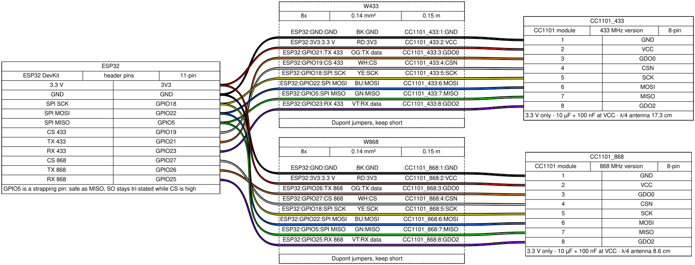
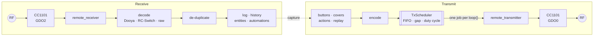

# ESP32 RF Sniffer & Bridge

[](https://github.com/lukasz-malicki-wrx/esp32-rf-sniffer/actions/workflows/ci.yml)
[](https://esphome.io)
[](LICENSE)

An ESP32 with two **CC1101** radios (433 MHz and 868 MHz) that listens to sub-GHz remotes,
decodes them, keeps a history of what it heard and can **re-transmit any captured
signal** - through a **serialised transmit queue**, because a radio can only put one
signal on air at a time.

It started as a replacement for an RFLink gateway driving the roller blinds in my house and
grew into a reusable [ESPHome external component](components/rf_bridge) with a
hardware-independent, unit-tested core.

Example log (serial console or the web UI):

```text
[I][rf_bridge]: [433] RX Dooya id=0x123456 ch=0x21 UP
[I][dooya]: Remote ch 0x21 -> Living room blind
[D][rf_bridge]: [433] TX 'Dooya id=0x123456 ch=0x21 UP' queued (1 pending)
[I][rf_bridge]: [433] TX Dooya id=0x123456 ch=0x21 UP (x6, 291 ms, 0 pending)
[I][rf_bridge]: [868] RX Raw 68 pulses 52ms
[D][rf_bridge]: [868]   raw[0]: 412 -1236 408 -1240 1228 -420 ...
```

## Features

- **Two bands, one firmware** - 433 MHz and 868 MHz CC1101 modules on a shared SPI bus,
  each with its own receiver, transmitter, queue and history.
- **Decoding** - Dooya (blinds), every RC-Switch protocol (sockets, doorbells, PIR...), and
  a raw pulse-train capture for anything else, printed to the log for analysis.
- **Repeat suppression** - one button press is reported once, however many bursts the
  remote sends and however long the button is held.
- **Capture & replay** - the last N frames per band are kept; pick one and press
  *Transmit selected*, or *Transmit last* to replay what was just heard (e.g. "blind up").
- **Serialised transmit queue** - buttons, covers, scenes and automations only enqueue;
  frames go on air one at a time with a quiet gap in between, in strict FIFO order.
- **Duty-cycle limiter** - optional sliding-window airtime budget per band (ETSI EN 300 220:
  1 % on 868 MHz, 10 % on 433 MHz).
- **Standalone** - logs and controls live on the device (serial console + built-in web
  UI). No Home Assistant required; the native API is an optional package.
- **Example integration** - time-based Dooya blinds whose state follows the physical
  remotes in the house.

## Hardware

| Part | Notes |
|---|---|
| ESP32 DevKit (ESP32-WROOM-32) | any classic ESP32 board |
| CC1101 module, **433 MHz** version | 8-pin breakout, SPI |
| CC1101 module, **868 MHz** version | matching network differs from the 433 MHz one |
| 2 × quarter-wave antenna | ~17.3 cm (433 MHz), ~8.6 cm (868 MHz) |
| 2 × (10 µF + 100 nF) | decoupling at each module |

### Wiring



| CC1101 | 433 MHz | 868 MHz |
|---|---|---|
| VCC / GND | 3V3 / GND | 3V3 / GND |
| SCK / MOSI / MISO | GPIO18 / GPIO22 / GPIO5 | shared |
| CSN | GPIO19 | GPIO27 |
| GDO0 (TX) | GPIO21 | GPIO26 |
| GDO2 (RX) | GPIO23 | GPIO25 |

Pin numbers, hardware notes and the bill of materials: **[docs/wiring.md](docs/wiring.md)**.
The harness diagram is generated with [WireViz](https://github.com/wireviz/WireViz) from
[`docs/wiring.yml`](docs/wiring.yml) (`scripts/render-wiring.sh`).

## Architecture



The decision-making code (frame model, de-duplication, queue, scheduler, duty-cycle
limiter) is plain C++ with no ESPHome dependency and is unit-tested on the host; the
ESPHome layer is a thin adapter. Details and sequence diagrams:
**[docs/architecture.md](docs/architecture.md)**.

## Quick start

```bash
pip install -r requirements-dev.txt       # pinned ESPHome + linters
cp secrets.example.yaml secrets.yaml      # Wi-Fi, keys, web UI login
esphome run rf-sniffer.yaml               # first flash over USB, OTA afterwards
```

Open `http://rf-sniffer.local/` and log in with the credentials from `secrets.yaml`:

1. press a button on a remote - it shows up in **433 last frame** / **868 last frame** and
   in the log view,
2. choose a slot in **capture slot** (1 = newest); **selected capture** shows what it holds,
3. press **transmit selected** - or **transmit last** for the newest capture.

Optional packages are enabled in `rf-sniffer.yaml`:

```yaml
packages:
  dooya_blinds: !include packages/dooya-blinds.yaml      # time-based covers for Dooya motors
  home_assistant: !include packages/home-assistant.yaml  # native API
```

## Configuration

```yaml
rf_bridge:
  - id: bridge_433
    band: "433"                # label used in logs
    receiver_id: rx_433        # remote_receiver
    transmitter_id: tx_433     # remote_transmitter (non_blocking: false); omit for RX-only
    queue_size: 20             # pending transmissions; new ones are rejected when full
    frame_gap: 100ms           # silence between two transmissions
    dedup_window: 1500ms       # repeats of the same frame within this window are ignored
    history_size: 8            # captured frames kept for replay
    duty_cycle: 10%            # or {limit: 1%, window: 1h}; omit to disable
    capture_raw: true          # keep undecodable frames ...
    raw_min_pulses: 24         # ... if they are at least this long
    repeat:                    # defaults per protocol, used for replay
      dooya: {times: 6, wait_time: 8ms}
      rc_switch: {times: 10}
      raw: {times: 5, wait_time: 10ms}
    on_dooya:                  # x: remote_base::DooyaData (id, channel, button, check)
      - logger.log: {format: "Dooya %06X", args: ["(unsigned) x.id"]}
    on_frame:                  # x: rf_bridge::RfFrame
      - lambda: ESP_LOGD("app", "%s", rf_bridge::protocol_name(x.protocol));
```

Entities (all optional) - platform `rf_bridge` with `rf_bridge_id`:

| Platform | Keys |
|---|---|
| `select` | `capture_slot` |
| `button` | `transmit_selected`, `transmit_last`, `clear_captures` |
| `text_sensor` | `last_frame`, `selected_capture` |
| `sensor` | `queue_depth`, `frames_received`, `duty_cycle_used` |

Actions - all of them enqueue, none of them blocks:

```yaml
- rf_bridge.transmit_dooya: {id: bridge_433, remote_id: 0x123456, channel: 0x21, button: 1}
- rf_bridge.transmit_rc_switch: {id: bridge_433, protocol: 1, code: 0x5A5A5A, nbits: 24}
- rf_bridge.transmit_capture: {id: bridge_868, slot: 1}   # 1 = newest
- rf_bridge.clear_captures: bridge_868
```

## Example: Dooya roller blinds

[`packages/dooya-blinds.yaml`](packages/dooya-blinds.yaml) turns the bridge into a blind
controller:

- each blind is a `time_based` cover (Dooya motors do not report position),
- the ESP sends with the id of a multi-channel remote the motors are already paired with,
  so no re-pairing is needed,
- `on_dooya` maps presses on the **physical** remotes to the right cover and updates its
  state *without* transmitting - the motor already got the command,
- an *All blinds* cover uses the remote's broadcast channel: one burst moves everything,
  and every cover state is updated to match.

Closing every blind from a scene is safe: the covers enqueue, the bridge sends one burst
after another.

## Design decisions

| Decision | Why |
|---|---|
| Transmit through a queue, consumed only in `loop()` | One signal on air at a time; producers never block or interleave. |
| Reject when the queue is full | Dropping an already queued command silently is worse than reporting the new one. |
| Gap measured from the *end* of a transmission | Receivers need silence between bursts; `non_blocking: false` gives the real end time. |
| Encode at enqueue time, queue raw timings | Airtime is known before sending, so the duty-cycle check is exact. |
| Sliding de-duplication window | A held button keeps repeating; it must stay one event. |
| Fixed capture slots + "selected capture" text sensor | ESPHome front-ends read select options once; changing labels would go stale. |
| Core without ESPHome headers | Logic is unit-tested on the host with sanitizers in CI. |
| Integer duty-cycle budget | `0.01f` is not 1 % in binary floating point; the tests caught it. |

## Testing

```bash
cmake -S tests -B build -G Ninja && cmake --build build && ctest --test-dir build
```

GoogleTest, built with `-Wall -Wextra -Wconversion -Werror` and AddressSanitizer + UBSan.
The suite covers the queue policies, de-duplication (including `millis()` wrap-around),
the duty-cycle window, frame fingerprints and the scheduler's ordering guarantees.

CI ([`.github/workflows/ci.yml`](.github/workflows/ci.yml)) runs on every push:

| Job | What |
|---|---|
| Lint | `ruff`, `clang-format`, `yamllint` |
| Wiring | renders `docs/wiring.yml` with WireViz, so a broken harness definition fails the build |
| Unit tests | host build of the core with sanitizers |
| Firmware | `esphome config` + `esphome compile` of the base config, and of a config with every optional package plus [`tests/esphome/actions.yaml`](tests/esphome/actions.yaml), which uses every action and trigger |

## Project structure

```text
.
├── rf-sniffer.yaml            # device config: pins + packages
├── packages/
│   ├── device.yaml            # Wi-Fi, OTA, logger, web UI, diagnostics
│   ├── radio-433.yaml         # CC1101 #1 + receiver/transmitter + bridge + entities
│   ├── radio-868.yaml         # CC1101 #2, same pipeline, 1 % duty cycle
│   ├── dooya-blinds.yaml      # optional: Dooya covers synced with physical remotes
│   ├── dooya-blind.yaml       #   one blind (included with vars)
│   └── home-assistant.yaml    # optional: native API
├── components/rf_bridge/
│   ├── __init__.py            # config schema, actions, triggers
│   ├── button.py select.py sensor.py text_sensor.py
│   ├── rf_bridge.{h,cpp}      # ESPHome glue: RX pipeline, TX loop, entities
│   ├── rf_bridge_entities.h   # button / select classes
│   ├── automation.h           # action classes
│   ├── rf_frame.{h,cpp}       # core: frame model, fingerprint, airtime
│   ├── frame_deduplicator.h   # core
│   ├── bounded_queue.h        # core
│   ├── tx_scheduler.h         # core
│   └── duty_cycle_limiter.h   # core
├── tests/                     # GoogleTest suite for the core
│   └── esphome/actions.yaml   #   CI package exercising every action and trigger
├── scripts/render-wiring.sh   # WireViz render in Docker
└── docs/
    ├── wiring.yml             # harness source (WireViz) -> images/wiring.svg, wiring.bom.tsv
    ├── wiring.md              # pinout, hardware notes
    └── architecture.md        # Mermaid diagrams: layers, RX/TX paths, radio state
```

## Limitations

- **OOK/ASK only.** `remote_receiver` sees demodulated pulses; FSK systems on 868 MHz
  (wM-Bus meters, HomeMatic, FS20) need the CC1101 packet mode and are out of scope.
- **Rolling codes** (KeeLoq garage doors, modern car keys) are captured as raw frames, but
  replaying them does nothing useful - by design of those systems.
- Use it on **your own devices** and respect the duty-cycle rules of your region.

## License

[MIT](LICENSE)
