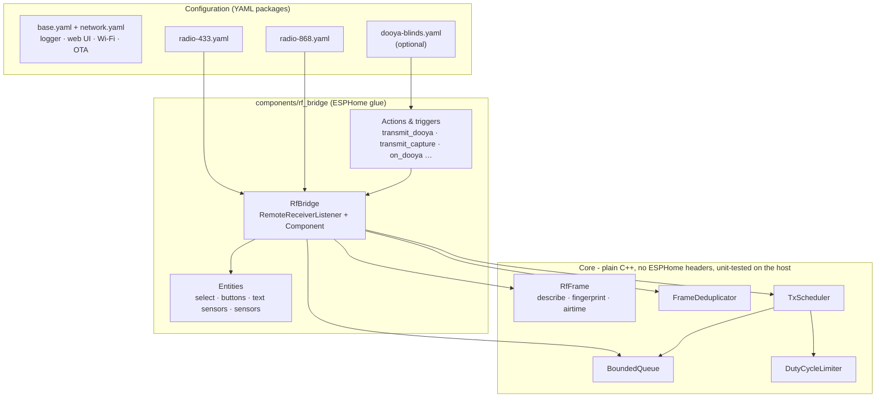
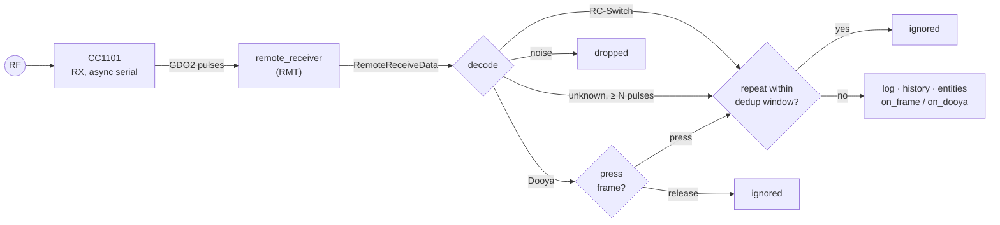
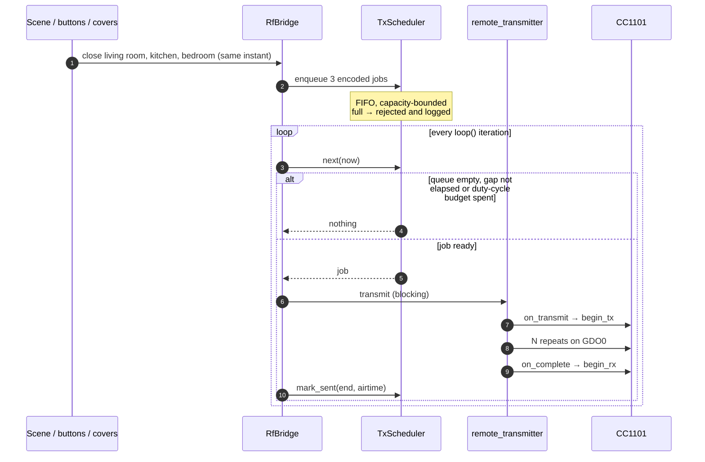
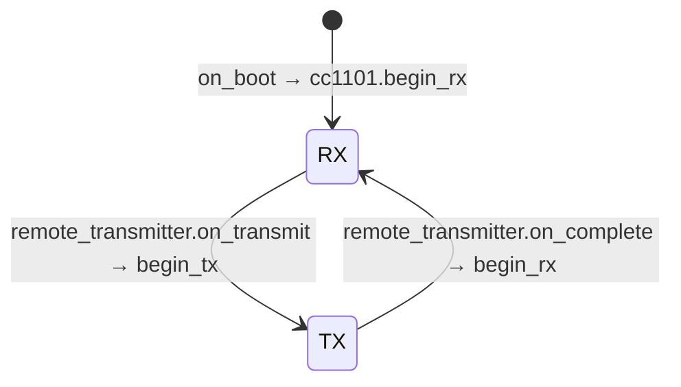

# Architecture

## Layers

The split is deliberate: everything that has a *decision* in it (is this a repeat? may I
transmit now? how long is this on air?) lives in the core and is covered by unit tests
that run in milliseconds on any machine. The glue layer only adapts ESPHome types and
calls into the core.

## Receive path

- **Decoders are tried in a fixed order** - Dooya first (strict, 40-bit with sync), then
  every RC-Switch protocol (at least 12 bits, to reject noise), then a raw capture fallback
  for anything long enough to be a real frame.
- **De-duplication** uses a sliding window keyed by a command fingerprint: a remote repeats
  a frame several times per press and keeps repeating while held, and the window slides
  with each repeat, so a long press is still one event. Raw frames are quantised to 100 µs
  before hashing, so timing jitter between repeats does not create new events.

## Transmit path

Why a queue at all? A radio can put exactly one signal on air at a time, and a receiver
needs a quiet gap to tell two commands apart. Without serialisation, a scene that closes
three blinds "at once" interleaves their bursts and some motors never see a valid frame.
Every producer therefore only *enqueues*; `loop()` is the single consumer.

Guarantees:

- **one transmission at a time per radio**, with a configurable gap measured from the real
  end of the previous transmission (`non_blocking: false`),
- **strict FIFO** - a job waiting for duty-cycle budget also holds the jobs behind it, so
  commands to the same device are never reordered,
- **bounded memory** - the queue rejects new jobs when full instead of growing,
- **regulatory airtime** - an optional sliding-window duty-cycle limit (ETSI EN 300 220:
  1 % in most of the 868 MHz SRD band).

## Radio state

The CC1101 is half-duplex: while one module transmits it hears nothing, which also means
the device never decodes its own transmissions on the same band.
