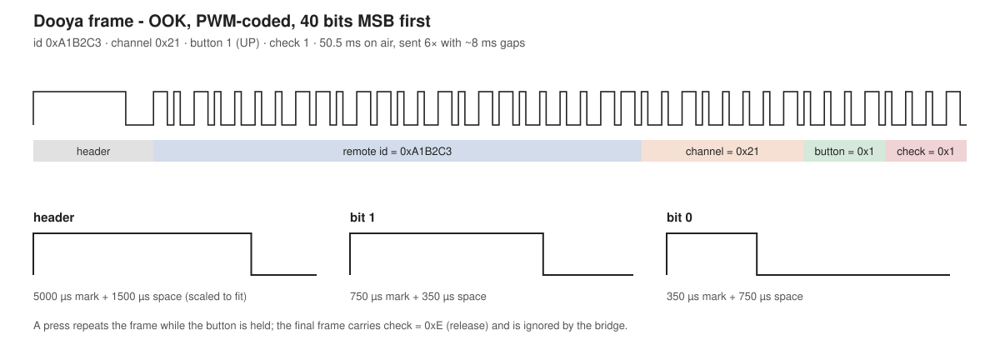
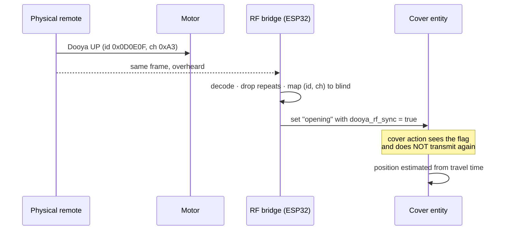

# Reverse-engineering my blinds: from RFLink to a native Dooya bridge

The roller blinds in my house have Dooya tubular motors. They used to be driven by an
**RFLink** gateway (a USB 433 MHz transceiver), which calls them `BrelMotor`.
This page describes how I worked out what is actually on air and rebuilt the control on
an ESP32 + CC1101 - without re-pairing a single motor.

> All remote ids on this page are replaced with made-up values. A Dooya remote id is
> effectively the key to the blinds, so the real ones live only in `secrets.yaml`.

## 1. What RFLink called "BrelMotor" is Dooya

RFLink is driven with its own text commands, e.g. "stop the blind on switch 23":

```text
10;BrelMotor;a1b2c3;23;STOP;
```

I put a CC1101 on an ESP32 next to it, with ESPHome's `remote_receiver` decoding every
protocol it knows, and sent that command. The ESP decoded it as a **Dooya** frame:

| RFLink command | Dooya frame on air |
|---|---|
| id `a1b2c3` | id `0xA1B2C3` |
| switch `23` | channel `0x23` |
| `STOP` | button `5`, check `5` |

RFLink's switch number is simply the channel byte written in hex, and "BrelMotor" is the
Dooya protocol under another name. That one observation meant the
motors could be driven by ESPHome's existing Dooya encoder: no custom protocol work, no
re-pairing.

## 2. The frame



| Part | Length | Meaning |
|---|---|---|
| header | 5000 µs mark + 1500 µs space | start of frame |
| remote id | 24 bits | identity of the remote the motor is paired with |
| channel | 8 bits | which motor(s) on that remote |
| button | 4 bits | `1` up, `3` down, `5` stop |
| check | 4 bits | equals `button` on a press, `0xE` on the release frame |

Bits are pulse-width coded, MSB first: a `1` is a long mark and a short space
(750 / 350 µs), a `0` the opposite (350 / 750 µs). One frame is ~50 ms on air. The diagram
is generated from the same timings ESPHome encodes with
([`scripts/plot_dooya_frame.py`](../scripts/plot_dooya_frame.py)).

## 3. Repeats, holds and releases

Capturing a single press showed **several identical frames ~7.6 ms apart**, more of them
for as long as the button is held, and finally one frame with `check = 0xE`.

That shaped two parts of the bridge:

- **Receive:** a sliding de-duplication window (1.5 s, refreshed by every repeat) turns one
  press - however long - into one event, and release frames are dropped outright
  (`DooyaCode::is_press()`).
- **Transmit:** the ESP mimics a real remote with 6 repeats and an 8 ms gap, which every
  motor in the house accepts reliably.

## 4. Two remotes, one set of motors

The house also has a physical 15-channel Dooya remote. Its frames carried a **different
remote id** than the one RFLink had been sending - the motors had simply been paired with
both. Going through the channels one by one gave a clean mapping:

| Physical remote (id `0x0D0E0F`) | RFLink / ESP clone (id `0xA1B2C3`) | Motor |
|---|---|---|
| channel `0xA1` ... `0xA9` | channel `0x21` ... `0x29` | one blind each |
| channel `0xA0` | channel `0x20` | all blinds |
| channel `0xAA` | - | both living-room blinds (group) |

So the ESP transmits as the clone id, but listens to **every** remote in the house - the
15-channel one and the single-channel wall remotes in each room - and maps each
`(remote id, channel)` to the blind it moves.

## 5. Keeping Home Assistant in sync

Dooya motors are one-way: they never report their position. Each blind is therefore a
`time_based` cover with travel times measured with a stopwatch (14-30 s per blind), and
the bridge closes the loop from the other side:



The `dooya_rf_sync` flag is the important detail: without it, updating the cover would
trigger its own `open_action`, the ESP would transmit, and the house would hear every
command twice.

## 6. What changed after the migration

| | RFLink | ESP32 + CC1101 bridge |
|---|---|---|
| Hardware | USB gateway tethered to a server | one ESP32 on Wi-Fi |
| Integration | serial protocol, separate HA integration | native ESPHome entities |
| Physical remotes | invisible to Home Assistant | update blind state live |
| "Close all" scene | commands could collide on air | queued, sent one after another |
| Unknown 433 MHz devices | protocol list compiled into RFLink | raw capture + replay from the web UI |
