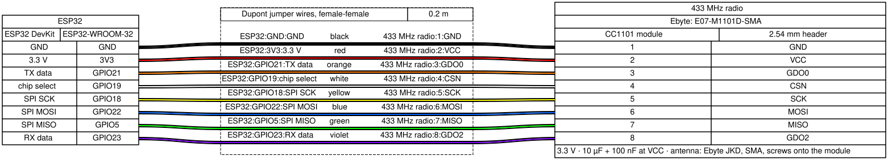
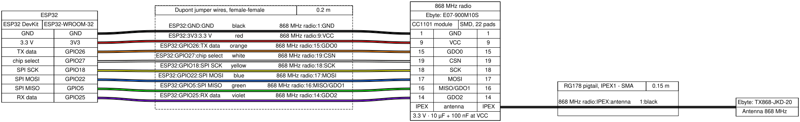

# Wiring

Two Ebyte CC1101 modules share one SPI bus (SCK, MOSI, MISO, plus 3.3 V and GND); each has
its own chip-select and its own pair of data lines - GDO0 carries the transmit data,
GDO2 the demodulated receive data.

## Hardware used

This is the exact set the firmware was built and tested with:

| Part | Model | Notes |
|---|---|---|
| MCU | ESP32 DevKit (ESP32-WROOM-32) | any classic ESP32 board |
| 433 MHz radio | **Ebyte E07-M1101D-SMA** | CC1101, 10 dBm, 8-pin 2.54 mm header, on-board SMA |
| 433 MHz antenna | **Ebyte JKD** SMA antenna | screws straight onto the module |
| 868 MHz radio | **Ebyte E07-900M10S** | CC1101, 855-925 MHz, 10 dBm, SMD module (22 castellated pads), IPEX connector |
| 868 MHz antenna | **Ebyte TX868-JKD-20** | SMA |
| RF cable | SMA pigtail, U.FL/IPEX1 to SMA bulkhead, RG178 | connects the E07-900M10S IPEX socket to the antenna |
| Interconnect | Dupont jumper wires, female-female | ~20 cm |
| Decoupling | 2 × (10 µF + 100 nF) | one pair at each module's VCC |

## 433 MHz - E07-M1101D-SMA

## 868 MHz - E07-900M10S

The diagrams are generated with [WireViz](https://github.com/wireviz/WireViz) from
[`wiring-433.yml`](wiring-433.yml) and [`wiring-868.yml`](wiring-868.yml). After editing
them, run `scripts/render-wiring.sh` (Docker, nothing to install locally). On each
diagram the ESP32 pins are listed in the module's pin order, so every wire runs
straight. Wire colours are the same on both: black GND, red 3V3, orange TX data,
white CS, yellow SCK, blue MOSI, green MISO, violet RX data.

## Pin table

| Signal | ESP32 (433) | E07-M1101D-SMA pin | ESP32 (868) | E07-900M10S pad |
|---|---|---|---|---|
| GND | GND | 1 | GND | 1 (also 2-5, 11, 12, 20, 22) |
| VCC 3.3 V | 3V3 | 2 | 3V3 | 9 |
| GDO0 - TX data | GPIO21 | 3 | GPIO26 | 15 |
| CSN - chip select | GPIO19 | 4 | GPIO27 | 19 |
| SCK | GPIO18 | 5 | GPIO18 (shared) | 18 |
| MOSI | GPIO22 | 6 | GPIO22 (shared) | 17 |
| MISO / GDO1 | GPIO5 | 7 | GPIO5 (shared) | 16 |
| GDO2 - RX data | GPIO23 | 8 | GPIO25 | 14 |
| Antenna | - | SMA | - | IPEX socket (or pad 21) |

Pin numbers come from the Ebyte user manuals of both modules. The two modules do **not**
share a pinout - the E07-M1101D is an 8-pin breakout, the E07-900M10S a 22-pad SMD part.
Every ESP32 pin is a substitution at the top of [`rf-sniffer.yaml`](../rf-sniffer.yaml),
so a different board only needs that block changed.

## Hardware notes

- **3.3 V only.** Neither module tolerates 5 V on VCC or on any signal line.
- **Band-specific modules and antennas.** CC1101 boards carry a matching network tuned for
  one band; never swap the antennas between the two radios.
- **Decoupling:** a 10 µF + 100 nF pair at each module's VCC keeps the ~36 mA transmit
  bursts of one radio from browning out the receiver of the other.
- **GPIO5 as MISO:** GPIO5 is an ESP32 strapping pin. It is safe here because both modules
  keep their SO line tri-stated while CSN is high, so nothing drives it during reset.
- **RMT channels:** the classic ESP32 has 512 RMT symbols; the configuration uses exactly
  2 × 192 (receivers) + 2 × 64 (transmitters). On an ESP32-S3 / C3 adjust `rmt_symbols`.
