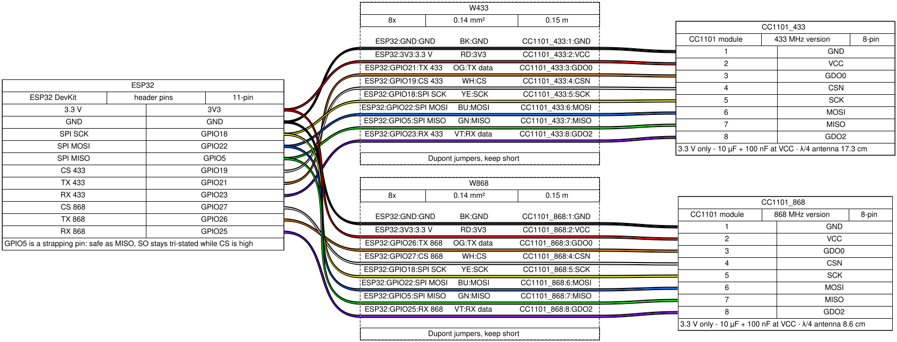

# Wiring

Two CC1101 modules share one SPI bus; each has its own chip-select and its own pair of
data lines (GDO0 for transmit, GDO2 for receive).

The diagram is generated from [`wiring.yml`](wiring.yml) with
[WireViz](https://github.com/wireviz/WireViz) - edit the YAML, then run
`scripts/render-wiring.sh` (Docker, no local install needed). The same run writes the
bill of materials to [`wiring.bom.tsv`](wiring.bom.tsv). Wire colours are identical on
both harnesses: black GND, red 3V3, orange TX data, white CS, yellow SCK, blue MOSI,
green MISO, violet RX data.

## Pin table

| CC1101 pin | Signal       | 433 MHz module | 868 MHz module | Notes                          |
|-----------:|--------------|----------------|----------------|--------------------------------|
| 1          | GND          | GND            | GND            |                                |
| 2          | VCC          | 3V3            | 3V3            | **3.3 V only** - not 5 V tolerant |
| 3          | GDO0         | GPIO21         | GPIO26         | TX data, from `remote_transmitter` |
| 4          | CSN          | GPIO19         | GPIO27         | separate chip-select per module |
| 5          | SCK          | GPIO18         | GPIO18         | shared SPI                     |
| 6          | MOSI (SI)    | GPIO22         | GPIO22         | shared SPI                     |
| 7          | MISO (SO)    | GPIO5          | GPIO5          | shared SPI                     |
| 8          | GDO2         | GPIO23         | GPIO25         | RX data, to `remote_receiver`  |

Every pin is a substitution at the top of [`rf-sniffer.yaml`](../rf-sniffer.yaml), so a
different board only needs that block changed.

> The pin numbering above is the common 8-pin CC1101 breakout (2 × 4 header). Some boards
> (10-pin, castellated) use a different order - always go by the silkscreen labels.

## Hardware notes

- **Use band-specific modules.** A CC1101 board has an RF matching network tuned for one
  band; a "433 MHz" module on 868 MHz loses most of its range. Buy one of each.
- **Antennas:** a quarter-wave wire is ~17.3 cm for 433 MHz and ~8.6 cm for 868 MHz.
  Keep the two antennas a few centimetres apart and away from the ESP32's own antenna.
- **Decoupling:** a 10 µF + 100 nF pair at each module's VCC pin keeps the 30 mA transmit
  bursts from browning out the receiver of the other module.
- **GPIO5 as MISO:** GPIO5 is an ESP32 strapping pin. It is safe here because both modules
  keep their SO line tri-stated while CSN is high, so nothing drives it during reset.
- **RMT channels:** the classic ESP32 has 512 RMT symbols; the configuration uses exactly
  2 × 192 (receivers) + 2 × 64 (transmitters). On an ESP32-S3 / C3 adjust `rmt_symbols`.
